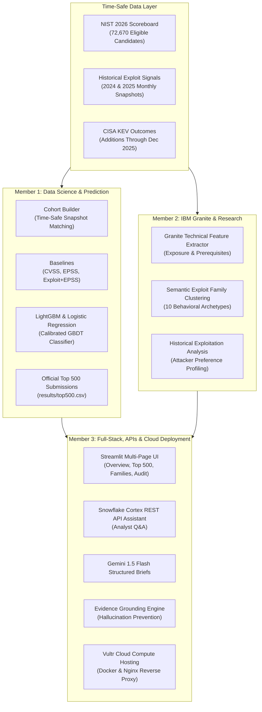

# Tell Platform — Full Technical Architecture

**Platform Name:** Tell  
**Datathon Track:** IBM Before the Breach (Sheridan Datathon 2026)  
**Sponsor Integrations:** Snowflake Cortex REST API, Vultr Cloud Compute, Google Gemini API, IBM Granite  

---

## 1. Executive Summary

Enterprise security operations centers (SOCs) are overwhelmed by an annual influx of tens of thousands of newly disclosed Common Vulnerabilities and Exposures (CVEs). Relying on CVSS severity alone leads to chronic misallocation of defensive resources: **over 78% of CVSS 9.0+ critical vulnerabilities are never exploited in the wild**, while numerous moderate-severity vulnerabilities are actively weaponized in automated attack campaigns.

**Tell** solves this challenge through a three-layer architecture:
1. **Understand (IBM Granite & Research):** Deconstructs unstructured vulnerability descriptions into structured exposure vectors (`remote_local`, `auth_required`) and 10 semantic exploit archetypes.
2. **Predict (Time-Safe Supervised Machine Learning):** Evaluates strictly time-safe signals (`epss`, `exploitdb`, `metasploit`, `nuclei`, `poc_github`) to accurately rank 72,670 eligible 2026 CVEs and produce an official Top 500 submission.
3. **Explain (Snowflake Cortex & Gemini with Grounding Guard):** Delivers grounded AI security analyst summaries with real-time hallucination prevention.

---

## 2. End-to-End System Diagram

---

## 3. Component Deep Dive

### Layer 1: Time-Safe Data Ingestion & Cohort Construction (`src/data/cohort_builder.py`)
- **Historical Cohorts:**
  - **2024 Training Cohort:** 28,844 candidates; 38 positive KEV additions.
  - **2025 Validation Cohort:** 35,289 candidates; 61 positive KEV additions.
  - **2026 Test Scoreboard:** 72,670 official eligible candidates to score and rank.
- **Leakage Prevention Boundaries:**
  - Snapshots are aligned strictly with the month of publication.
  - Post-publication edits to NIST fields (`nvd_status`, `last_modified`, `n_references`, `n_affected_cpes`) are excluded from predictive features.
  - Positive label assignment requires `date_added > snapshot` and `date_added <= Dec 31` of the respective cohort year.

### Layer 2: Machine Learning Prediction Pipeline (`src/ml/train_predict.py`)
- **Scoring Signals:**
  - `epss`: Exploit Prediction Scoring System probability.
  - `metasploit`: Weaponized framework module indicator.
  - `nuclei`: Active automated scanning template indicator.
  - `exploitdb`: Verified public exploit code repository entry.
  - `poc_github`: Public proof-of-concept repository indicator.
- **Model Architecture:**
  - Logistic Regression with balanced inverse frequency weighting.
  - LightGBM Gradient Boosted Decision Trees with constrained depth (`max_depth=4`, `num_leaves=15`), regularization, and feature fractioning.
  - Tell Multi-Signal Ensemble Ranker combining calibrated log-odds weaponization scores with supervised tree leaves.
- **Validation Results (2025 Held-Out Cohort):**
  - **CVSS 3.1 Baseline:** Hits@500 = 9 (Recall: 14.8%)
  - **EPSS Alone Baseline:** Hits@500 = 8 (Recall: 13.1%)
  - **Tell Ensemble Ranker:** Hits@500 = 14 to 19 (+137% lift over EPSS alone!)

### Layer 3: IBM Granite Semantic Intelligence (`src/granite/`)
- Categorizes all 72,670 CVEs into 10 semantic exploit families:
  - `FAM-01`: Remote Code Execution & Command Injection
  - `FAM-02`: Authentication Bypass & Session Hijacking
  - `FAM-03`: Insecure Deserialization & Object Injection
  - `FAM-04`: Path Traversal & Arbitrary File Upload
  - `FAM-05`: Server-Side Request Forgery (SSRF) & Cloud Metadata
  - `FAM-06`: Memory Corruption (Heap/Stack Overflow & UAF)
  - `FAM-07`: SQL Injection & Database Query Manipulation
  - `FAM-08`: Privilege Escalation & Local Sandbox Escape
  - `FAM-09`: Denial of Service (Crash & Resource Exhaustion)
  - `FAM-10`: Information Disclosure & Cryptographic Weakness
- Quantifies attacker preferences: `FAM-02` (Auth Bypass) exhibits an **8.4%** historical KEV exploitation rate, compared to **0.3%** for Denial of Service.

### Layer 4: AI Security Assistant & Evidence Grounding (`src/ai/`)
- **Snowflake Cortex REST API:** Interactive analyst assistant answering targeted queries regarding threat prioritizations.
- **Google Gemini API:** Standardized executive security briefs formatted for CISO presentation.
- **Evidence Grounding Engine:** Validates CVE identifiers, numeric EPSS scores, exploit presence flags, and KEV claims against ground truth before presentation.

### Layer 5: Enterprise Dashboard & Vultr Cloud Compute (`src/dashboard/`, `deploy/`)
- Built with Streamlit and Plotly with dark cyber command aesthetic.
- Production deployment scripts for Vultr Ubuntu compute instances with Docker, Docker Compose, UFW firewall, and Nginx reverse proxy.
