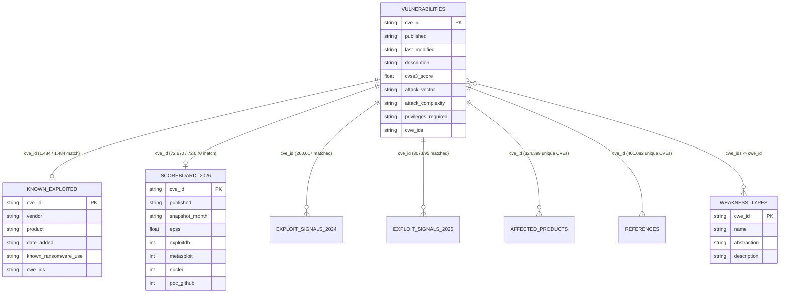

# IBM Granite Dataset Audit & Relational Schema

**Project:** ThreatRank — Sheridan Datathon 2026 (IBM Track: *Before the Breach*)  
**Component:** Member 2 — IBM Granite Intelligence & Research  
**Branch:** `feature/granite`

---

## 1. Executive Summary

All eight original IBM challenge CSV datasets located in `c:\Users\johnj\OneDrive\Documentos\Datathon 2026\dataset\data\data\` were audited using memory-efficient inspection. Notice that the files on disk do not carry the browser download suffixes (`(2)`, `(3)`, `(4)`), though our data loader (`src/granite/load_data.py`) automatically resolves both suffixed and unsuffixed filenames.

| Dataset File | Disk Size | Rows | Columns | Primary / Unique Key | Exact Duplicates | Key Role |
| :--- | :---: | :---: | :---: | :--- | :---: | :--- |
| `vulnerabilities.csv` | 227.15 MB | 401,082 | 30 | `cve_id` (401,082 unique) | 0 | Core CVE descriptions, publication dates, CVSS v2/v3/v4 metrics, CWE IDs |
| `weakness_types.csv` | 0.32 MB | 1,374 | 6 | `cwe_id` (1,374 unique) | 0 | Official CWE taxonomy names, abstractions, and descriptions |
| `known_exploited.csv` | 0.58 MB | 1,484 | 10 | `cve_id` (1,484 unique) | 0 | CISA KEV catalog entries with `date_added` through `2025-12-29` |
| `scoreboard_2026.csv` | 3.44 MB | 72,670 | 8 | `cve_id` (72,670 unique) | 0 | Official 2026 target benchmark CVEs (`2026-01-01` to `2026-09-30`) |
| `exploit_signals_2024.csv` | 116.37 MB | 3,023,284 | 8 | `(cve_id, month)` | 0 | Monthly point-in-time EPSS, KEV status, and public exploit flags (`2024-01` to `2024-12`) |
| `exploit_signals_2025.csv` | 132.49 MB | 3,440,450 | 8 | `(cve_id, month)` | 0 | Monthly point-in-time EPSS, KEV status, and public exploit flags (`2025-01` to `2025-12`) |
| `affected_products.csv` | 190.14 MB | 3,155,934 | 11 | Composite (1:N per `cve_id`) | 0 | CPE vendor, product, and version range mappings for 324,399 unique CVEs |
| `references.csv` | 138.22 MB | 1,360,487 | 4 | `(cve_id, url)` | 0 | External advisory URLs, domains, and reference tags for all 401,082 CVEs |

---

## 2. Dataset Relationship Diagram

---

## 3. Detailed Per-File Audit

### 3.1 `vulnerabilities.csv` (alias `vulnerabilities(4).csv`)
- **Purpose:** Master table of CVE disclosures, English text descriptions, CVSS v2/v3/v4 metrics, and CWE classifications.
- **Shape:** 401,082 rows × 30 columns.
- **Primary Key:** `cve_id` (100% unique, 0 missing, 0 duplicates).
- **Time Coverage:** `published` spans `1988-10-01` to `2026-11-06`. `last_modified` spans `2026-06-16` to `2026-11-06`.
- **Schema & Missingness:**
  - Zero missing values (`0.00%`): `cve_id`, `published`, `last_modified`, `nvd_status`, `assigner`, `description`, `n_references`, `n_affected_cpes`.
  - CVSS v3 fields (`cvss3_version`, `cvss3_score`, `cvss3_severity`, `cvss3_vector`, `attack_vector`, `attack_complexity`, `privileges_required`, `user_interaction`, `scope`, `confidentiality_impact`, `integrity_impact`, `availability_impact`, `cvss3_exploitability_score`, `cvss3_impact_score`, `cvss3_source`): **84,738 missing (21.13%)**.
  - `cwe_ids` (`str`, comma-separated when multiple): **61,297 missing (15.28%)**.
  - CVSS v4 fields (`cvss4_score`, `cvss4_severity`, `cvss4_vector`): **355,835 missing (88.72%)**.
  - CVSS v2 fields (`cvss2_score`, `cvss2_severity`, `cvss2_vector`): **203,913 missing (50.84%)**.
- **Data Quality & Leakage Findings:**
  - `last_modified`, `nvd_status`, `n_references`, and `n_affected_cpes` reflect cumulative post-publication updates (`last_modified` is in mid-to-late 2026 even for older CVEs). Using them as historical predictive features introduces severe temporal leakage.
  - Even on the 2026 benchmark (`scoreboard_2026.csv`, 72,670 CVEs), **6,348 CVEs (8.74%) lack `cvss3_score` / `attack_vector` / `privileges_required`**, and **4,953 CVEs (6.82%) lack `cwe_ids`**, whereas **100% (72,670 / 72,670) have non-empty `description` text**. This makes IBM Granite description embeddings essential for complete benchmark coverage.

### 3.2 `weakness_types.csv` (alias `weakness_types(3).csv`)
- **Purpose:** Reference dictionary of Common Weakness Enumeration (CWE) definitions.
- **Shape:** 1,374 rows × 6 columns (`cwe_id`, `name`, `kind`, `abstraction`, `status`, `description`).
- **Primary Key:** `cwe_id` (1,374 unique, 0 duplicates).
- **Missingness:** `abstraction` missing in 411 rows (`29.91%`, primarily CWE Categories/Views); `status` missing in 2 rows (`0.15%`); `cwe_id`, `name`, `kind`, `description` have 0 missing.
- **Connection:** Joins to `vulnerabilities.cwe_ids` after splitting multi-valued CWE strings (e.g., `"CWE-79, CWE-89"`).

### 3.3 `known_exploited.csv` (alias `known_exploited(4).csv`)
- **Purpose:** Historical ground-truth additions to CISA's Known Exploited Vulnerabilities (KEV) catalog through the end of 2025.
- **Shape:** 1,484 rows × 10 columns (`cve_id`, `vendor`, `product`, `name`, `date_added`, `short_description`, `required_action`, `due_date`, `known_ransomware_use`, `cwe_ids`).
- **Primary Key:** `cve_id` (1,484 unique, 0 duplicates). Every single KEV `cve_id` (`1,484 / 1,484`) is present in `vulnerabilities.csv`.
- **Time Coverage:** `date_added` spans `2021-11-03` to `2025-12-29`.
- **Missingness:** `cwe_ids` missing in 166 rows (`11.19%`); all other columns 0% missing.
- **Leakage Precaution:** Contains zero 2026 scoreboard CVEs (`0` overlap with `scoreboard_2026.csv`). When evaluating historical cohorts at a cutoff $T$, only KEV entries with `date_added` carefully bounded relative to $T$ are valid.

### 3.4 `scoreboard_2026.csv` (alias `scoreboard_2026(4).csv`)
- **Purpose:** Official 2026 evaluation benchmark cohort from which the top 500 predicted KEV additions are selected.
- **Shape:** 72,670 rows × 8 columns (`cve_id`, `published`, `snapshot_month`, `epss`, `exploitdb`, `metasploit`, `nuclei`, `poc_github`).
- **Primary Key:** `cve_id` (72,670 unique, 0 duplicates). 100% (`72,670 / 72,670`) join cleanly to `vulnerabilities.csv`.
- **Time Coverage:** `published` spans `2026-01-01` to `2026-09-30`; `snapshot_month` spans `2026-01` to `2026-09`.
- **Missingness:** `epss` missing in 1,431 rows (`1.97%`); all other columns 0% missing.

### 3.5 `exploit_signals_2024.csv` & `exploit_signals_2025.csv`
- **Purpose:** Monthly longitudinal snapshots of exploitation indicators (`epss`, `in_kev`, `exploitdb`, `metasploit`, `nuclei`, `poc_github`).
- **Shape:**
  - `exploit_signals_2024.csv`: 3,023,284 rows × 8 columns (`month` from `2024-01` to `2024-12`; 271,590 unique CVEs).
  - `exploit_signals_2025.csv`: 3,440,450 rows × 8 columns (`month` from `2025-01` to `2025-12`; 319,677 unique CVEs).
- **Primary Key:** `(cve_id, month)` — 0 duplicates in either file.
- **Missingness:** `epss` missing in 648 rows (`0.02%`) in 2024 and 1,259 rows (`0.04%`) in 2025.
- **Data Quality Note:** Contains ~11.5k older CVEs not present in `vulnerabilities.csv`, while matching 260,017 (2024) and 307,895 (2025) CVEs in `vulnerabilities.csv`.

### 3.6 `affected_products.csv` (alias `affected_products(2).csv`)
- **Purpose:** CPE vendor, product, and version range mappings per CVE.
- **Shape:** 3,155,934 rows × 11 columns (`cve_id`, `type`, `vendor`, `product`, `version`, `update`, `version_start_including`, `version_start_excluding`, `version_end_including`, `version_end_excluding`, `vulnerable`).
- **Join Key:** `cve_id` (1:N relationship; covers 324,399 unique CVEs in `vulnerabilities.csv`).
- **Data Quality Note:** High missingness in optional version boundary fields (`84.9%–99.98%`), and 551,249 repeated `(cve_id, vendor, product, version)` combinations due to distinct `update` or CPE platform configurations. Must be aggregated (`groupby('cve_id')`) before joining to CVE-level tables to prevent row explosion.

### 3.7 `references.csv` (alias `references(2).csv`)
- **Purpose:** External hypertext references and advisory tags per CVE.
- **Shape:** 1,360,487 rows × 4 columns (`cve_id`, `url`, `domain`, `tags`).
- **Primary Key:** `(cve_id, url)` — 0 duplicates. Covers all 401,082 CVEs in `vulnerabilities.csv`.
- **Missingness:** `tags` missing in 617,660 rows (`45.40%`).

---

## 4. Existing Structured Features vs. IBM Granite Value-Add

In `vulnerabilities.csv`, structured CVSS v3 and CWE columns already exist (`attack_vector`, `privileges_required`, `attack_complexity`, `cvss3_score`, `cwe_ids`):
1. **No Redundant LLM Guessing When Structured Data Exists:** When `attack_vector` (`NETWORK`, `ADJACENT_NETWORK`, `LOCAL`, `PHYSICAL`) or `privileges_required` (`NONE`, `LOW`, `HIGH`) are present in NVD metadata, our extraction pipeline uses them directly (`extraction_method = "structured_cvss"`) and documents the exact mapping rather than overwriting reliable structured fields with heuristics.
2. **Filling the Missingness Gap (21.1% Overall, 8.7% on 2026 Scoreboard):** For the 84,738 CVEs (including 6,348 in `scoreboard_2026.csv`) where CVSS v3 is missing, deterministic lexical extraction (`extraction_method = "deterministic_rule"`) parses explicit phrases (`"unauthenticated remote attacker"`, `"local user"`) from the description and defaults conservatively to `"unknown"` when ambiguous.
3. **True Semantic Discovery via IBM Granite Embeddings:** `ibm-granite/granite-embedding-small-english-r2` encodes the full narrative mechanics of each vulnerability into 384-dimensional dense vectors, grouping semantically equivalent exploit chains across fragmented CWE IDs and isolating high-risk sub-families within broad CWE classes.

