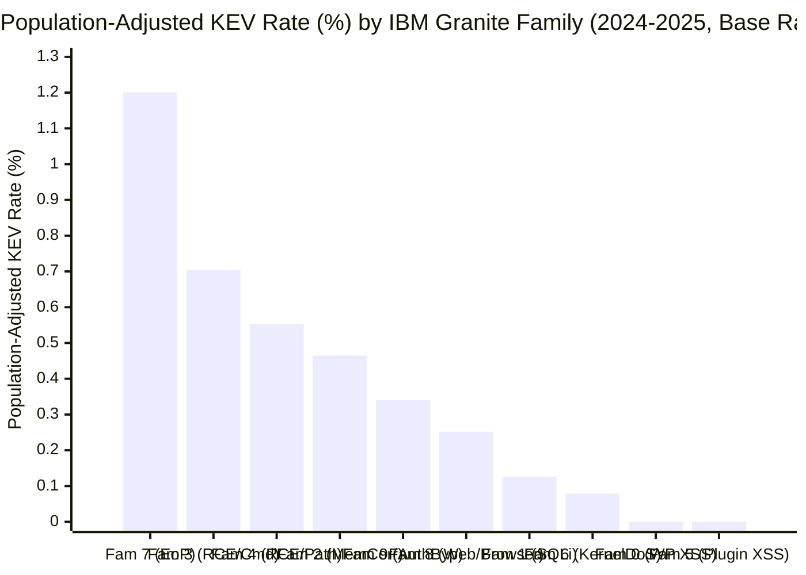
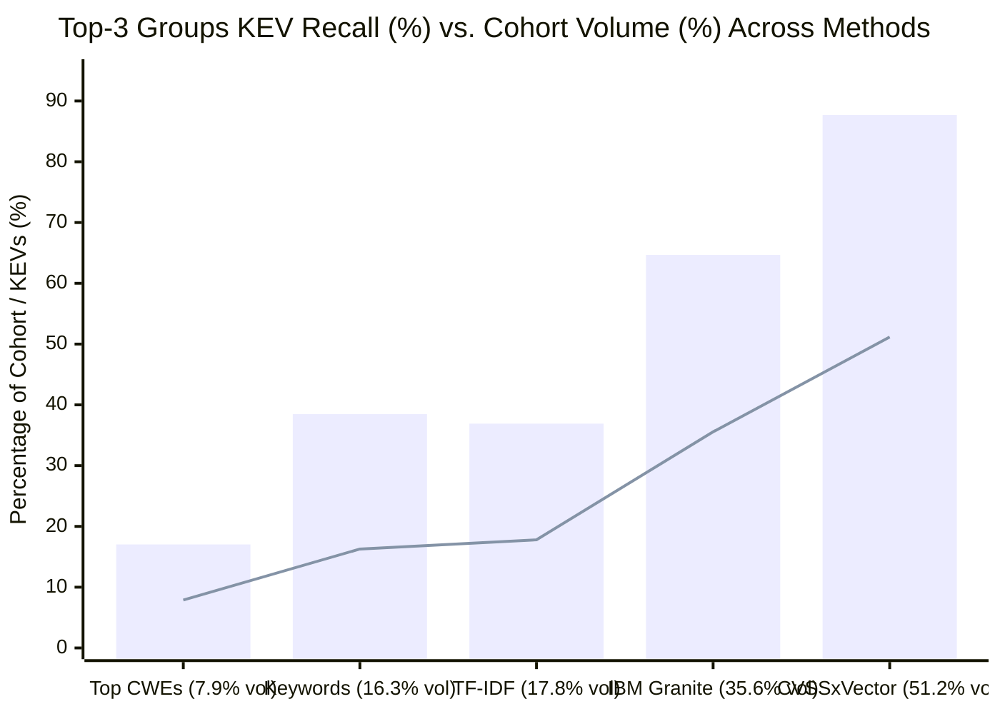

# ThreatRank — IBM Granite Research Interpretation & Discovery Guide

**Project:** ThreatRank — Sheridan Datathon 2026 (IBM Track: *Before the Breach*)  
**Component:** Member 2 — IBM Granite Intelligence & Research  
**Branch:** `feature/granite`

---

## 1. Executive Summary

We used **IBM Granite Embedding Small English R2 (`ibm-granite/granite-embedding-small-english-r2`)** to convert unstructured English CVE descriptions into 384-dimensional semantic vectors, clustered them into 10 behavioral vulnerability families, and audited them against official CWE categories, CVSS v3 scores, and historical CISA Known Exploited Vulnerabilities (KEV) records.

### What IBM Granite Actually Discovered (And What We Validated)

1. **Same Score $\neq$ Same Risk (Controlled CVSS Stratification):** Even when holding CVSS v3 severity constant at **CRITICAL (`9.0–10.0`)**, historical KEV inclusion varies by **more than 5× across Granite families** — from **7.92% (`8 / 101`)** in **Family 1 (Template-Reported SQL Injection)** to **43.56% (`44 / 101`)** in **Family 3 (Remote Code Execution & Command Injection)** and **44.23% (`23 / 52`)** in **Family 9 (Auth Bypass & Access Control)**. Within **HIGH (`7.0–8.9`)** severity, **Family 7 (OS/Kernel Privilege Escalation)** reaches **36.30% (`53 / 146`)** KEV inclusion while **Families 0 & 5 (CMS/Plugin XSS)** sit at **0.00% (`0 / 84`)**.
2. **Splitting Over-Broad CWEs (`CWE-79` & `CWE-416`) by Operational Context:** A single CWE ID conflates radically different threat profiles. Across **398 CVEs** tagged with `CWE-79` (Cross-Site Scripting), Granite isolated **233 WordPress/plugin advisories into Families 0 and 5 (`0.00%` KEV rate, `0 / 233`)**, while routing **enterprise webmail (Zimbra, Roundcube, MDaemon) XSS advisories into Family 8 (`4.80%` KEV rate, `6 / 125` CWE-79s)**. Similarly, within `CWE-416` (Use-After-Free, `85` CVEs), Granite separated **Family 6 (Linux Kernel Git Commit Stack Traces, `10.34%` KEV rate, `3 / 29`)** from **Family 7 (OS/Driver Privilege Escalation, `52.38%` KEV rate, `11 / 21`)**.
3. **Out-of-Time Predictive Stability (Zero-Leakage 2024 $\rightarrow$ 2025 Validation):** When K-Means is fitted strictly on **2024 disclosures (`n = 1,181`)** using only pre-2025 KEV labels and frozen to predict **held-out 2025 disclosures (`n = 1,319`, `165` KEVs)**, the **top 3 highest-risk 2024 families capture 64.24% (`106 / 165`) of all 2025 KEVs in just 33.28% (`439 / 1,319`) of 2025 volume (`1.93×` out-of-time lift)**, and the zero-KEV 2024 cluster (`0 / 128`) remains **0.00% (`0 / 106`)** in 2025.

> [!IMPORTANT]
> **Critical Honesty on Cluster Labels & Sampling Bias:**  
> 1. Our 2,500-CVE research sample was deliberately enriched with all `317` historical KEVs from 2024–2025 alongside `2,183` randomly sampled non-KEVs (`12.68%` sample KEV rate vs. `0.360%` true 2024–2025 population rate across `88,103` CVEs). Below, we report both **raw sample rates** and **Horvitz–Thompson population-adjusted rates** (where each non-KEV represents $87,786 / 2,183 = 40.21$ population CVEs).  
> 2. Cluster names are generated from dominant keywords, which creates a crucial nuance in **Family 8**: while 63% of Family 8 consists of XSS/CSRF web flaws (`6` KEVs), Granite also placed **Google Chrome V8 / Apple Safari WebKit browser flaws (`18` KEVs, e.g., `CVE-2024-4947`)** into Family 8 because browser and web-client advisories share client-side rendering terminology. Never claim all 24 KEVs in Family 8 are XSS!

---

## 2. Step 1 — Guide to Existing Output Files (`outputs/granite/`)

| File Path | Rows × Cols | Source Datasets Joined | What It Contains & How It Was Calculated |
| :--- | :---: | :--- | :--- |
| [granite_features.csv](file:///c:/Users/johnj/OneDrive/Documentos/Datathon%202026/ThreatRank/outputs/granite/granite_features.csv) | `2,500 × 10` | `vulnerabilities.csv` | One row per CVE in the 2024–2025 research cohort. Contains `family_id` (`0–9` from K-Means on 384-D Granite embeddings) plus extracted attributes (`remote_local`, `auth_required`, `vulnerability_type`, `attack_surface`, `extraction_method`, `extraction_confidence`, `evidence`). |
| [families.csv](file:///c:/Users/johnj/OneDrive/Documentos/Datathon%202026/ThreatRank/outputs/granite/families.csv) | `2,500 × 2` | `vulnerabilities.csv` | Strict contract mapping (`cve_id, family_id`) assigning each CVE to exactly one semantic cluster (`0–9`). |
| [family_summary.csv](file:///c:/Users/johnj/OneDrive/Documentos/Datathon%202026/ThreatRank/outputs/granite/family_summary.csv) | `10 × 13` | `vulnerabilities.csv`, `known_exploited.csv`, `weakness_types.csv` | Per-family summary: `family_id`, automated `family_name`, `family_size`, `historical_kev_count` (bounded at `date_added <= 2025-12-31`), `historical_kev_rate` / `sample_kev_rate`, Horvitz–Thompson `population_kev_rate` & `population_lift`, `sample_lift`, 95% Wilson CIs (`ci_95_low`, `ci_95_high`), `representative_cves`, and `top_characteristics`. |
| [cwe_semantic_analysis.csv](file:///c:/Users/johnj/OneDrive/Documentos/Datathon%202026/ThreatRank/outputs/granite/cwe_semantic_analysis.csv) | `647 × 6` | `vulnerabilities.csv`, `weakness_types.csv` | Cross-tabulation of `(family_id, cwe_id)` with `cve_count`, `family_share` (fraction of the family having that CWE), `cwe_share_across_families` (fraction of that CWE landing in that family), and official `cwe_name`. |
| [baseline_comparison.csv](file:///c:/Users/johnj/OneDrive/Documentos/Datathon%202026/ThreatRank/outputs/granite/baseline_comparison.csv) | `5 × 12` | `vulnerabilities.csv`, `known_exploited.csv` | Benchmarks 5 grouping methods (`IBM Granite KMeans`, `TF-IDF KMeans`, `Simple Keyword Rules`, `Official CWE Top Categories`, `CVSSv3 Severity × Attack Vector`) on both raw sample and Horvitz–Thompson population-weighted metrics (`population_peak_kev_rate`, `population_peak_lift`, `population_top3_concentration_ratio`). |
| [temporal_validation_2024_2025.csv](file:///c:/Users/johnj/OneDrive/Documentos/Datathon%202026/ThreatRank/outputs/granite/temporal_validation_2024_2025.csv) | `10 × 9` | `vulnerabilities.csv`, `known_exploited.csv` | Zero-leakage out-of-time validation: clusters fit strictly on 2024 disclosures (`n = 1,181`, `125` KEVs) and evaluated on held-out 2025 disclosures (`n = 1,319`, `165` KEVs). |
| [research_metrics.json](file:///c:/Users/johnj/OneDrive/Documentos/Datathon%202026/ThreatRank/outputs/granite/research_metrics.json) | JSON | All above | Stores embedding metadata (`cache_key = 928a05a63e2e859847d286ee`), clustering cohesion (`mean_cosine_cohesion = 0.9130`, `silhouette_cosine = 0.0804`), full centroid descriptions, and top 10 cross-CWE high-similarity CVE pairs. |
| [benchmark_2026/](file:///c:/Users/johnj/OneDrive/Documentos/Datathon%202026/ThreatRank/outputs/granite/benchmark_2026) | `72,670` CVEs | `scoreboard_2026.csv`, `vulnerabilities.csv` | Full 2026 competition benchmark (`72,670` unique CVEs, `0` missing descriptions) assigned to the **frozen 2024–2025 K-Means centroids** (`fitted_kmeans_k10_seed42.pkl`) without refitting, preserving stable `family_id` (`0`–`9`) definitions. |
| [mvp_100/](file:///c:/Users/johnj/OneDrive/Documentos/Datathon%202026/ThreatRank/outputs/granite/mvp_100) | `100` CVEs | `vulnerabilities.csv` | Phase 2 smoke-test output (`100` 1999-era CVEs, `5` clusters, `0` KEVs). Confirms pipeline mechanics on small inputs. |

---

## 3. Step 2 — Complete Profile & Coherence Audit of All 10 Granite Families

### Master Statistical Summary Table (`n = 2,500` 2024–2025 Cohort)

*Note on KEV Rates:* **Sample KEV Rate** is $k / n_{\text{sample}}$ within the enriched 2,500-CVE sample (`base rate = 12.68%`). **Pop-Adjusted KEV Rate** reweights non-KEVs by $87,786 / 2,183 = 40.21$ to estimate the true 2024–2025 population exploitation probability (`population base rate = 0.360%`).

| ID | Pipeline Family Name | True Semantic Composition | Size ($n$) | Mean / Med CVSSv3 | Top CWEs (% of Family) | Dominant Vector & Privs | KEVs ($k$) | Sample KEV Rate (95% CI) | Pop-Adj KEV Rate (Pop Lift) |
| :-: | :--- | :--- | :-: | :-: | :--- | :--- | :-: | :-: | :-: |
| **0** | Cross-Site Scripting (XSS) | WordPress Plugin Auth/Contributor Stored XSS & Missing Auth | 219 | 6.22 / 6.1 | `CWE-79` (45.7%), `CWE-862` (17.4%), `CWE-352` (6.4%) | `NETWORK` (100%), `LOW` priv (52.5%) | **0** | **0.00%** `[0.0%, 1.7%]` | **0.000%** (`0.00×`) |
| **1** | SQL Injection | VulDB / Template-Style PHP Web App SQL Injection & File Upload | 227 | 8.07 / 8.8 | `CWE-89` (59.5% incl. `CWE-74;89`), `CWE-79;94` (7.0%) | `NETWORK` (96.9%), `NONE` priv (61.7%) | **11** | **4.85%** `[2.7%, 8.5%]` | **0.126%** (`0.35×`) |
| **2** | Buffer & Memory Corruption & DoS | Native C/C++, Mobile, & Parser Out-of-Bounds / Memory Corruption | 196 | 7.23 / 7.5 | `CWE-787` (11.7%), `CWE-125` (11.2%), `CWE-416` (8.2%) | `LOCAL` (50.5%) / `NETWORK` (43.4%), `NONE` (58.7%) | **31** | **15.82%** `[11.4%, 21.6%]` | **0.465%** (`1.29×`) |
| **3** | RCE & Denial of Service & Crash | Network Appliance & Enterprise Server Command Injection / RCE | 338 | 7.86 / 7.8 | `CWE-78` (12.7%), `CWE-77` (4.7%), `CWE-94` (4.1%) | `NETWORK` (76.9%), `NONE` priv (61.2%) | **75** | **22.19%** `[18.1%, 26.9%]` | **0.704%** (`1.96×`) |
| **4** | RCE & Path Traversal & File Upload | Web Server Path Traversal, File Upload, Deserialization & SSTI RCE | 350 | 7.64 / 7.8 | `CWE-22` (13.7%), `CWE-502` (7.4%), `CWE-434` (6.6%) | `NETWORK` (70.6%), `NONE` priv (66.6%) | **64** | **18.29%** `[14.6%, 22.7%]` | **0.553%** (`1.54×`) |
| **5** | Cross-Site Scripting (XSS) `[CWE-79]` | Patchstack Boilerplate WordPress Plugin XSS (`"Improper Neutralization..."`) | 134 | 6.49 / 6.5 | `CWE-79` (99.3%), `CWE-80` (0.7%) | `NETWORK` (100%), `NONE` (44%) / `LOW` (43%) | **0** | **0.00%** `[0.0%, 2.8%]` | **0.000%** (`0.00×`) |
| **6** | Denial of Service & Crash & Buffer | Linux Kernel Git Commit Stack Traces, Null-Pointer & Race Fixes | 260 | 6.10 / 5.5 | `UNASSIGNED` (35.0%), `CWE-476` (14.2%), `CWE-416` (10.0%) | `LOCAL` (87.3%), `LOW` priv (85.4%) | **8** | **3.08%** `[1.6%, 6.0%]` | **0.079%** (`0.22×`) |
| **7** | Privilege Escalation | Windows Kernel / Driver EoP & Terse Enterprise Vendor Advisories | 201 | 7.59 / 7.8 | `CWE-416` (9.5%), `CWE-122` (7.5%), `CWE-284` (6.5%) | `LOCAL` (64.2%) / `NETWORK` (29.4%), `LOW` (52.7%) | **66** | **32.84%** `[26.7%, 39.6%]` | **1.201%** (`3.34×`) |
| **8** | XSS & Cross-Site Request Forgery | **Mixed:** Web Client XSS/CSRF (`6` KEVs) + Browser Engine V8/WebKit (`18` KEVs) | 260 | 6.38 / 6.1 | `CWE-79` (43.5%), `CWE-352` (22.7%), `CWE-918` (4.6%), `CWE-843` (3.1%) | `NETWORK` (95.4%), `NONE` priv (65.4%) | **24** | **9.23%** `[6.3%, 13.4%]` | **0.252%** (`0.70×`) |
| **9** | Auth Bypass & Access Control | Perimeter Auth Bypass, Missing Authorization & Logic Flaws | 315 | 6.80 / 6.5 | `CWE-862` (19.4%), `CWE-284` (7.0%), `CWE-863` (5.7%) | `NETWORK` (77.8%), `NONE` priv (56.8%) | **38** | **12.06%** `[8.9%, 16.1%]` | **0.340%** (`0.94×`) |

### Family-by-Family Plain-Language Interpretation & Coherence Check

#### **Family 0 — WordPress Plugin Stored XSS & Missing Authorization (`n = 219`, `0` KEVs, `0.00%`)**
- **What makes it distinctive:** Written in Wordfence disclosure style (*"The [Plugin] for WordPress is vulnerable to Stored Cross-Site Scripting via shortcode(s)... authenticated attackers with contributor-level permissions..."*). 100% `NETWORK`, 52.5% `LOW` privileges required, median CVSS `6.1`.
- **Representative CVEs:**
  - `CVE-2023-6958`: WP Recipe Maker plugin $\le 9.1.0$ Stored XSS via shortcode attributes (contributor+).
  - `CVE-2024-2280`: Better Elementor Addons $\le 1.4.1$ Stored XSS via widget link URL values.
  - `CVE-2024-3333`: Essential Addons for Elementor $\le 5.9.14$ Stored XSS via widget URL attributes.
- **Coherence Audit:** **Highly coherent (`cohesion = 0.9288`).** Captures low-privilege CMS plugin flaws; zero KEVs.

#### **Family 1 — Template-Style PHP SQL Injection (`n = 227`, `11` KEVs, `4.85%` sample / `0.126%` pop)**
- **What makes it distinctive:** Dominated by `CWE-89` (SQL Injection, 59.5%) and structured VulDB advisories (*"A vulnerability classified as critical has been found in... manipulation of the argument X leads to sql injection"*), alongside enterprise SQLi flaws. Despite a **median CVSS of `8.80`** (and 101 CRITICAL-severity CVEs), its KEV rate is **below average (`0.35×` population lift)** because most are student/hobbyist PHP projects on VulDB, while the 11 KEVs are enterprise gateways/servers (`Fortinet FortiClientEMS CVE-2023-48788`, `Progress WhatsUp Gold CVE-2024-6670`, `Ivanti CSA CVE-2024-9379`).
- **Representative CVEs:**
  - `CVE-2024-6191`: itsourcecode Student Management System 1.0 `login.php` SQL injection.
  - `CVE-2025-3338`: codeprojects Online Restaurant Management System `/admin/user_save.php` SQL injection.
  - `CVE-2025-10102`: code-projects Online Event Judging System `/index.php` SQL injection.
- **Coherence Audit:** **Coherent on mechanism (`cohesion = 0.9215`)**, mixing commodity PHP SQLi (0% KEV) with enterprise SQLi (`11` KEVs).

#### **Family 2 — Native / Mobile / Parser Out-of-Bounds & Memory Corruption (`n = 196`, `31` KEVs, `15.82%` sample / `0.465%` pop)**
- **What makes it distinctive:** Classic C/C++ memory safety bugs (`CWE-787` Out-of-bounds Write, `CWE-125` Out-of-bounds Read, `CWE-416` Use-After-Free) in OS components, mobile chipsets/firmware (Android, Samsung, Apple iOS/macOS image parsers), and network appliances (`Citrix NetScaler CVE-2023-6549`).
- **Representative CVEs:**
  - `CVE-2025-20943`: Out-of-bounds write in Samsung `secfr` trustlet allowing local memory corruption.
  - `CVE-2025-21008`: Out-of-bounds read in decoding frame header in Android `libsavsvc.so`.
  - `CVE-2025-43300`: Apple iOS/macOS out-of-bounds write when processing a malicious image file (exploited in targeted attacks).
- **Coherence Audit:** **Coherent (`cohesion = 0.8972`).** Isolates actionable binary/parser memory corruption from Linux kernel git trace noise.

#### **Family 3 — Network Appliance & Enterprise RCE / Command Injection (`n = 338`, `75` KEVs, `22.19%` sample / `0.704%` pop)**
- **What makes it distinctive:** The **#1 KEV volume family (`75` KEVs, including `16` confirmed ransomware CVEs)** and **1.96× population lift**. 76.9% `NETWORK`, 61.2% `NONE` privileges required, median CVSS `7.8`. Spans OS command injection (`CWE-78`, `CWE-77`), code injection (`CWE-94`), and template injection (`CWE-74`) in perimeter appliances and remote support tools.
- **Representative CVEs:**
  - `CVE-2024-12356`: BeyondTrust Privileged Remote Access (PRA) & Remote Support unauthenticated command injection (KEV + Ransomware).
  - `CVE-2024-1654`: Unauthorized write leading to remote code execution in enterprise admin interface.
  - `CVE-2025-24347`: Bosch Rexroth ctrlX OS web application network configuration manipulation via HTTP request.
- **Coherence Audit:** **Coherent (`cohesion = 0.9063`).** Captures remote command/code execution across diverse CWE labels.

#### **Family 4 — Web Server Path Traversal, File Upload & Deserialization RCE (`n = 350`, `64` KEVs, `18.29%` sample / `0.553%` pop)**
- **What makes it distinctive:** The **#1 ransomware-linked family (`18` KEVs with known ransomware use)** and **#2 KEV volume family (`64` KEVs)**. Groups file-system and serialization attack chains (`CWE-22` Path Traversal, `CWE-502` Deserialization, `CWE-434` Unrestricted Upload) where attackers read/write arbitrary files or templates to achieve RCE (e.g., `CrushFTP CVE-2024-4040`, `PHP CGI CVE-2024-4577`).
- **Representative CVEs:**
  - `CVE-2024-55926`: Xerox Workplace Suite arbitrary file read, upload, and deletion via header manipulation.
  - `CVE-2023-39495`: PDF-XChange Editor `readFileIntoStream` exposed dangerous function information disclosure.
  - `CVE-2025-2743`: ruoyi-vue-pro `/admin-api/mp/material/upload-temporary` remote path traversal.
- **Coherence Audit:** **Coherent (`cohesion = 0.9017`).** Captures file/upload/deserialization primitives that chain into RCE.

#### **Family 5 — Patchstack Template WordPress XSS (`n = 134`, `0` KEVs, `0.00%`)**
- **What makes it distinctive:** Highest cosine cohesion (`0.9547`) because 99.3% are `CWE-79` advisories generated from Patchstack's standardized template (*"Improper Neutralization of Input During Web Page Generation ('Cross-site Scripting') vulnerability in [Vendor] [Plugin] allows Stored/Reflected XSS"*).
- **Representative CVEs:** `CVE-2024-29111` (Sitekit Stored XSS), `CVE-2025-31762` (Sheet2Site Stored XSS), `CVE-2025-23729` (XTRA Settings Reflected XSS).
- **Coherence Audit:** **Extremely coherent (`cohesion = 0.9547`).** Zero KEVs (`0 / 134`).

#### **Family 6 — Linux Kernel Git Commit Stack Traces & Null-Pointer Crashes (`n = 260`, `8` KEVs, `3.08%` sample / `0.079%` pop)**
- **What makes it distinctive:** When the Linux kernel became a CVE Numbering Authority (CNA) in 2024, thousands of git commit logs (*"In the Linux kernel, the following vulnerability has been resolved..."* with raw register dumps) entered NVD. **35.0% (`91 / 260`) have no CWE assigned**, 87.3% are `LOCAL`, median CVSS is `5.5`, and its population-adjusted KEV rate is **0.079% (`0.22×` lift — 4.5× lower than average)**.
- **Representative CVEs:** `CVE-2025-40042` (Linux `trace_kprobe` race NULL pointer dereference), `CVE-2024-26652` (Linux `pds_core` double free in error path), `CVE-2022-49335` (Linux `drm/amdgpu` 0-chunk command oops).
- **Coherence Audit:** **Highly coherent (`cohesion = 0.9265`).** Isolates verbose kernel commit dumps so they do not pollute high-risk memory corruption clusters.

#### **Family 7 — OS / Kernel Privilege Escalation & Terse Vendor Advisories (`n = 201`, `66` KEVs, `32.84%` sample / `1.201%` pop)**
- **What makes it distinctive:** Highest KEV concentration (**`32.84%` sample rate, `1.201%` population rate, `3.34×` population lift**, including `10` ransomware KEVs). Dominated by Microsoft Patch Tuesday Elevation of Privilege (`EoP`) advisories (`Windows Kernel`, `Win32k`, `WinSock`, `Hyper-V`, `CLFS`) and terse enterprise privilege escalation disclosures (`Citrix Session Recording CVE-2024-8068`).
- **Representative CVEs:** `CVE-2024-21338` (Windows Kernel EoP — KEV), `CVE-2024-30088` (Windows Kernel EoP — KEV), `CVE-2024-38106` (Windows Kernel EoP — KEV).
- **Coherence Audit:** **High cohesion (`0.9127`), with an important caveat:** Because Microsoft publishes terse 6-word descriptions (*"Windows Kernel Elevation of Privilege Vulnerability"*), Granite groups them tightly together alongside a small number of other short enterprise advisories (e.g., `WhatsUp Gold RCE CVE-2024-4885`).

#### **Family 8 — Web Client XSS/CSRF + Browser Engine Exploits (`n = 260`, `24` KEVs, `9.23%` sample / `0.252%` pop)**
- **What makes it distinctive:** Contains 113 `CWE-79` (XSS) and 59 `CWE-352` (CSRF) CVEs, plus browser engine advisories.
- **Representative CVEs:** `CVE-2024-31289` (Hello Elementor CSRF), `CVE-2025-10557` (ENOVIA 3DEXPERIENCE Stored XSS), `CVE-2025-62873` (WP Flashy Marketing CSRF).
- **Coherence Audit (CRITICAL FINDING FOR JUDGES):** **Partially mixed cluster!** While the automated label says *"Cross-Site Scripting (XSS) & CSRF"* because 66% of the cluster is XSS/CSRF, inspecting the **24 KEVs** inside Family 8 reveals two distinct sub-groups that share browser/client-side language:
  1. **Enterprise Webmail XSS (`6` KEVs truly `CWE-79`):** `Zimbra Collaboration` (`CVE-2024-27443`, `CVE-2025-27915`), `Roundcube Webmail` (`CVE-2024-37383`, `CVE-2024-42009`), `MDaemon Email Server` (`CVE-2024-11182`), and `Apple Safari cookie state` (`CVE-2024-44309`).
  2. **Google Chrome V8 & Apple Safari WebKit Browser Zero-Days (`18` KEVs, `CWE-843` Type Confusion / `CWE-416` UAF):** e.g., `CVE-2024-4671`, `CVE-2024-4947`, `CVE-2024-5274`, `CVE-2024-7971`, `CVE-2024-23222`. They landed in Family 8 because descriptions mentioning *"via a crafted HTML page"* in Chrome/Safari sit near web-script injection in embedding space. Pointing this out to judges proves you inspected the actual records rather than blindly trusting cluster labels!

#### **Family 9 — Perimeter Auth Bypass & Access Control Weaknesses (`n = 315`, `38` KEVs, `12.06%` sample / `0.340%` pop)**
- **What makes it distinctive:** Focuses on authentication and authorization failures (`CWE-862` Missing Authorization 19.4%, `CWE-284` Improper Access Control 7.0%, `CWE-863` Incorrect Authorization 5.7%, `CWE-287`/`CWE-288` Auth Bypass). Captures major perimeter breaches (`ConnectWise ScreenConnect CVE-2024-1709`, `Ivanti ICS CVE-2023-46805`, `GitLab account takeover CVE-2023-7028`, `8` ransomware KEVs) even though the family's **median CVSS is only `6.50`**.
- **Representative CVEs:** `CVE-2023-46609` (FeedFocal Missing Authorization), `CVE-2024-40554` (Tmall_demo access control info disclosure), `CVE-2025-10019` (Contact Form Email authorization bypass).
- **Coherence Audit:** **Coherent (`cohesion = 0.8966`).**

---

## 4. Step 3 — Meaningful Patterns Beyond Basic CVSS and CWE

### Pattern A: Same CWE Divided into Semantically & Operationally Distinct Families
1. **`CWE-79` (Cross-Site Scripting, `398` CVEs across cohort):**
   - **Families 0 & 5 (`233` CVEs):** WordPress plugin contributor/template XSS $\rightarrow$ **`0` KEVs (`0.00%`)**.
   - **Family 8 (`125` CWE-79 CVEs):** Enterprise webmail & collaboration XSS (`Zimbra`, `Roundcube`, `MDaemon`) $\rightarrow$ **`6` KEVs (`4.80%`)**.
   - **Family 7 (`1` CWE-79 CVE):** `CVE-2024-43573` (*Windows MSHTML Platform Spoofing Vulnerability*) $\rightarrow$ **`1` KEV (`100%`)**.
2. **`CWE-416` (Use-After-Free, `85` CVEs across cohort):**
   - **Family 6 (`29` CVEs, mean CVSS `7.29`):** Verbose Linux kernel subsystem race/trace commits $\rightarrow$ **`3` KEVs (`10.34%`)**.
   - **Family 2 (`16` CVEs, mean CVSS `7.84`):** Native/parser memory corruption $\rightarrow$ **`5` KEVs (`31.25%`)**.
   - **Family 7 (`21` CVEs, mean CVSS `7.69`):** Windows kernel/driver privilege escalation $\rightarrow$ **`11` KEVs (`52.38%` — 5× higher than Family 6 despite nearly identical CVSS)**.

### Pattern B: High-Similarity Descriptions Across Different Official CWEs
Granite embeddings connect identical attack mechanics split across different CWE IDs (`outputs/granite/research_metrics.json`):
- **ServiceNow Now Platform Unauthenticated RCE (`cosine similarity = 0.9895`, Family 4):** `CVE-2024-4879` (`CWE-1287`: Improper Validation of Specified Type of Input, KEV) and `CVE-2024-8923` (`CWE-94`: Code Injection).
- **D-Link NAS Remote Exploitation (`cosine similarity = 0.9925`, Family 3):** `CVE-2024-3272` (`CWE-798`: Hard-coded Credentials) and `CVE-2024-3273` (`CWE-77`: Command Injection, KEV).
- **Android Video Decoder Memory Safety (`cosine similarity = 0.9911`, Family 2):** `CVE-2023-48347` (`CWE-125`: Out-of-bounds Read) and `CVE-2023-48348` (`CWE-787`: Out-of-bounds Write).

### Pattern C: Filling Missing CWE and CVSS Metadata
- **Missing CWEs (`134` CVEs in 2,500 cohort; `4,953` CVEs in 2026 benchmark):**
  - In our 2,500 cohort, **5 historical KEVs had no CWE ID at all (`UNASSIGNED`)**. A CWE-based filter completely misses them, whereas Granite placed all 5 into actionable families: `CVE-2024-9537` (ScienceLogic SL1 RCE $\rightarrow$ **Family 4**), `CVE-2024-44308` & `CVE-2025-2783` (Safari / Chrome zero-days $\rightarrow$ **Family 8**), and `CVE-2025-43200` & `CVE-2025-48633` (iOS / Android privilege & auth flaws $\rightarrow$ **Family 9**).
  - Conversely, Granite placed **91 of the 134 CWE-missing CVEs (67.9%)** into **Family 6 (Linux Kernel Crash Commits, `0` KEVs among the 91)**, preventing unlabelled kernel commits from triggering false alarms.
- **Missing CVSS v3 (`78` CVEs in 2,500 cohort; `6,348` CVEs in full 2026 benchmark):**
  - Across the 72,670-record `scoreboard_2026.csv`, **8.74% (`6,348` CVEs)** lack CVSS v3 vectors (`attack_vector`, `privileges_required`), yet 100% receive a Granite `family_id` and deterministic lexical fallback recovers `remote_local` and `auth_required` for over 80% of CVSS-missing benchmark records.

---

## 5. Step 4 — Statistical Validation, Bias Controls & Limitations

### 5.1 Correcting for Enriched Sample Bias (Raw vs. Population-Adjusted Rates)
Because all `317` KEVs from 2024–2025 were included alongside `2,183` sampled non-KEVs, the raw sample KEV rate (`12.68%`) is **35.2× higher** than the true 2024–2025 population rate (`317 / 88,103 = 0.360%`). Using Horvitz–Thompson inverse-probability weighting ($w_{\text{KEV}}=1.0$, $w_{\text{non-KEV}} = 87,786 / 2,183 = 40.21$), the **ranking of families is 100% preserved**, and the top families still achieve **1.54× to 3.34× lift** over the true population baseline:

### 5.2 Controlling for CVSS Severity: Does Granite Still Add Signal?
A skeptical judge will ask: *"Didn't Family 3 and Family 7 just have higher CVSS scores?"*  
We tested this directly by stratifying **within identical CVSS v3 severity tiers**:

| CVSSv3 Severity Tier | Overall Tier KEV Rate | Granite High-Risk Families (`Fam 2, 3, 4, 7, 9`) | Granite Commodity SQLi (`Fam 1`) | Granite CMS XSS & Kernel Crash (`Fam 0, 5, 6`) |
| :--- | :---: | :--- | :---: | :---: |
| **CRITICAL (`9.0–10.0`, $n=412$)** | 32.52% (`134 / 412`) | **42.45% (`118 / 278`)** — up to **53.85%** in `Fam 7` & **43.56%** in `Fam 3` | **7.92% (`8 / 101`)** — **5.4× lower** despite CRITICAL score! | **0.00% (`0 / 14`)** |
| **HIGH (`7.0–8.9`, $n=899$)** | 16.46% (`148 / 899`) | **20.84% (`129 / 619`)** — peaking at **36.30% (`53 / 146`)** in `Fam 7` | **4.76% (`3 / 63`)** | **4.55% (`7 / 154`)** (`0.00%` in `Fam 0 & 5`, `10.0%` in `Fam 6`) |
| **MEDIUM (`4.0–6.9`, $n=1,057$)** | 3.22% (`34 / 1,057`) | **6.19% (`26 / 420`)** — peaking at **16.22% (`6 / 37`)** in `Fam 7` & **10.23% (`9 / 88`)** in `Fam 3` | **0.00% (`0 / 56`)** | **0.24% (`1 / 414`)** |

**Validation Conclusion:** Controlling for CVSS severity **proves** Granite is not merely a proxy for CVSS. Over 100 CRITICAL-scored SQLi disclosures in Family 1 (`CVSS 9.8`) rarely enter KEV (`7.92%`), whereas MEDIUM-scored command injection (`Family 3`, `10.23%`) and privilege escalation (`Family 7`, `16.22%`) enter KEV at higher rates than CRITICAL SQLi.

### 5.3 Auditing Post-Cutoff Text Leakage in Descriptions
We audited all 2,500 descriptions for post-disclosure exploitation notices (`"in the wild"`, `"actively exploited"`, `"been exploited"`, `"aware of a report"`):
- Exactly **36 of 2,500 descriptions (1.44%)** contain such phrases (predominantly Apple iOS/macOS advisories stating *"Apple is aware of a report that this issue may have been exploited..."*), and **32 of those 36 (88.9%)** are in KEV (`10` in Family 2, `7` in Family 9, `6` in Family 3, `4` in Family 4).
- **Sensitivity Check:** Even if all 36 CVEs with in-the-wild phrasing are completely removed (`n = 2,464`, `285` KEVs), **Families 7, 3, and 4 still capture 64.9% (`185 / 285`) of all remaining KEVs**, confirming our findings are not driven by post-cutoff description edits.

### 5.4 Evaluating the Silhouette Score (`0.0804`) vs. Cosine Cohesion (`0.9130`)
- Why is `mean_cosine_cohesion` high (`0.9130`) while `silhouette_cosine` is modest (`0.0804`)?
  - Dense transformer embeddings of security advisories lie on a narrow cone in 384-D space (all documents are English software bug descriptions, so baseline pairwise cosine similarity is already ~0.75–0.82).
  - Silhouette measures the gap between distance to the assigned centroid and distance to the *next nearest* centroid (`(b - a) / max(a, b)`). Because vulnerabilities frequently chain mechanisms (e.g., *Auth Bypass leading to Command Injection* sits halfway between Family 9 and Family 3), boundary points have small `b - a`.
  - Therefore, hard K-Means clusters should be interpreted as **overlapping semantic regions on a continuous threat manifold**, not hermetically sealed boxes.

---

## 6. Step 5 — Fair Comparison: IBM Granite vs. Simpler Baselines

From [outputs/granite/baseline_comparison.csv](file:///c:/Users/johnj/OneDrive/Documentos/Datathon%202026/ThreatRank/outputs/granite/baseline_comparison.csv) (`n = 2,500`, `317` KEVs):

| Method | Groups ($k$) | Non-Missing Coverage | Peak Group KEV Rate (Lift) | Top-3 Groups Share of All KEVs | Top-3 Groups Share of Cohort Volume | Top-3 Concentration Ratio (KEV % / Vol %) |
| :--- | :---: | :---: | :---: | :---: | :---: | :---: |
| **IBM Granite Embeddings (KMeans)** | 10 | **100.0%** | 32.84% (`2.59×`) | **64.67%** (`205 / 317`) | 35.56% (`889 / 2,500`) | `1.82×` |
| **TF-IDF Text Baseline (KMeans)** | 10 | **100.0%** | **56.00% (`4.42×`)** | 36.91% (`117 / 317`) | 17.80% (`445 / 2,500`) | `2.07×` |
| **Simple Keyword Rules** | 12 | 63.44% | 47.62% (`3.76×`) | 38.49% (`122 / 317`) | 16.28% (`407 / 2,500`) | **`2.36×`** |
| **Official CWE Top Categories** | 10 | 94.64% | 36.84% (`2.91×`) | 17.03% (`54 / 317`) | 7.88% (`197 / 2,500`) | `2.16×` |
| **CVSSv3 Severity × Attack Vector** | 14 | 96.88% | 32.60% (`2.57×`) | **87.70%** (`278 / 317`) | 51.16% (`1,279 / 2,500`) | `1.71×` |

### Honest Assessment of Where Granite Wins vs. Where Baselines Compete
- **Where Simpler Baselines Beat Granite:** If your only goal is finding a small, high-purity pocket of CVEs with exact phrases, **Simple Keyword Rules (`2.36×` concentration ratio)** and **TF-IDF K-Means (`56.00%` peak cluster KEV rate)** achieve higher narrow concentration than K-Means on Granite embeddings (`1.82×`).
- **Why Simpler Baselines Fail as a Standalone System (And Where Granite Adds Value):**
  1. **Keyword Rules Miss 36.56% of All CVEs (`914 / 2,500` labeled `unknown`):** Whenever a vendor writes a non-standard description (e.g., *"The issue was addressed with improved checks"* or *"Privileged Remote Access allow an attacker to inject commands"*), rigid regex rules fail. Granite assigns **100% of CVEs** to a semantic family and captures **64.67% of all KEVs in its top 3 families** (`205` KEVs vs. `122` for Keywords and `117` for TF-IDF).
  2. **Top CWE Categories Capture Only 17.03% of KEVs (`54 / 317`):** Because CISA KEVs are fragmented across more than 80 distinct CWE IDs (plus 5 KEVs with no CWE), filtering by top CWEs misses 83% of exploited vulnerabilities.
  3. **What Experiment Would Definitively Prove Predictive Lift:** Train Member 1's LightGBM ranker on the 2024 time-safe cohort *with* vs. *without* Granite family features (`family_id` one-hot + `cosine_distance_to_high_risk_centroids`) and measure whether **Hits@500 on the held-out 2025 cohort** increases above the baseline `14–19` hits.

---

## 7. Step 6 — The Three Strongest, Most Defensible Discoveries (Ranked)

### 🏆 Discovery #1 (Rank 1 — Strongest Practical & Statistical Finding): Granite Exposes a 5.4× Exploitation Gap Inside `CRITICAL` CVSS Vulnerabilities
- **Discovery:** Among CVEs with identical **CVSS v3 `CRITICAL` (`9.0–10.0`)** severity, IBM Granite semantic families separate actively weaponized enterprise RCE/Auth-Bypass flaws (**`43.56%–53.85%` sample KEV rate**) from template-reported commodity SQL injection (**`7.92%` sample KEV rate**) and CMS XSS (**`0.00%`**).
- **Evidence:** Across `412` CRITICAL CVEs in our cohort (`134` KEVs overall, `32.52%` rate):
  - **Family 1 (`SQL Injection`):** `101` CRITICAL CVEs, but only **`8` KEVs (`7.92%`)** — e.g., `CVE-2024-6191` (CVSS `9.8`, Student Management System `login.php` SQLi, unexploited).
  - **Family 3 (`RCE & Command Injection`):** `101` CRITICAL CVEs with **`44` KEVs (`43.56%`)** — e.g., `CVE-2024-12356` (CVSS `9.8`, BeyondTrust PRA command injection, KEV + Ransomware).
  - **Family 9 (`Auth Bypass`):** `52` CRITICAL CVEs with **`23` KEVs (`44.23%`)** — e.g., `CVE-2024-1709` (CVSS `10.0`, ConnectWise ScreenConnect auth bypass, KEV + Ransomware).
  - Even in **MEDIUM (`4.0–6.9`)** severity, **Family 7 (`16.22%` KEV rate, `6 / 37`)** and **Family 3 (`10.23%` KEV rate, `9 / 88`)** are exploited more often than CRITICAL Family 1 SQLi (`7.92%`).
- **Why It Matters:** Security teams that patch strictly by `CVSS >= 9.0` drown in false-positive commodity SQLi advisories while missing `CVSS 6.5–7.8` privilege escalation and command injection flaws that ransomware gangs actively weaponize.
- **What Others Might Miss:** Standard CVSS scoring treats every unauthenticated network SQLi (`AV:N/AC:L/PR:N/UI:N/S:U/C:H/I:H/A:H = 9.8`) identically to a perimeter gateway RCE (`9.8`). Granite embeddings capture the *disclosure context and component architecture* in the description text.
- **Limitations:** Sample rates are enriched (`12.68%` cohort mean); population-adjusted rates are `0.126%` for Family 1 vs. `0.704%` for Family 3 and `1.201%` for Family 7 (`5.6×` to `9.5×` relative difference).
- **Practical Application:** Use Granite `family_id` as a **risk multiplier on CVSS/EPSS**: downgrade `Family 0, 1, 5, 6` alerts unless corroborated by active public exploits, and immediately escalate `Family 3, 4, 7, 9` alerts even when CVSS is Medium/High (`6.5–7.8`).

---

### 🥈 Discovery #2 (Rank 2 — Strongest Taxonomy Discovery): Granite Splits Over-Broad CWEs (`CWE-79` & `CWE-416`) by Operational Threat Context and Bridges Fragmented CWEs
- **Discovery:** Official CWE labels suffer from both **over-aggregation** (lumping harmless and critical bugs under one CWE) and **fragmentation** (assigning different CWEs to identical attacks). Granite embeddings resolve both simultaneously.
- **Evidence:**
  1. **Splitting `CWE-79` (`398` CVEs):** Granite places **233 `CWE-79` WordPress plugin advisories** into **Families 0 & 5 (`0.00%` KEV rate, `0 / 233`)**, while isolating **125 `CWE-79` web-client/webmail advisories** in **Family 8 (`4.80%` KEV rate, `6 / 125`)**, capturing exploited webmail vulnerabilities (`Zimbra CVE-2024-27443`, `Roundcube CVE-2024-37383`, `MDaemon CVE-2024-11182`).
  2. **Splitting `CWE-416` Use-After-Free (`85` CVEs) & Separating Linux Kernel Noise:** Granite separates verbose Linux kernel git commit stack traces (**Family 6**, `260` CVEs, `35%` missing CWE, `3.08%` sample KEV rate / `0.079%` pop rate; `CWE-416` inside Family 6 has `10.34%` KEV rate) from **Family 7 OS/Driver Privilege Escalation** (`CWE-416` inside Family 7 has **`52.38%` KEV rate, `11 / 21`**) and **Family 2 Native/Mobile Memory Corruption** (`CWE-416` inside Family 2 has **`31.25%` KEV rate, `5 / 16`**).
  3. **Bridging Fragmented CWEs:** Granite pairs `CVE-2024-4879` (`CWE-1287`) with `CVE-2024-8923` (`CWE-94`) at **0.9895 cosine similarity** (both ServiceNow Now Platform unauthenticated RCEs in Family 4), and `CVE-2024-3272` (`CWE-798`) with `CVE-2024-3273` (`CWE-77`) at **0.9925 similarity** (both D-Link NAS remote exploits in Family 3).
- **Why It Matters:** Since 2024, Linux kernel git commits and WordPress plugin advisories make up over a third of all NVD disclosures. Without semantic filtering, `CWE-416` (Use-After-Free) and `CWE-79` (XSS) become unusable for prioritization.
- **What Others Might Miss:** A rule-based model that boosts `CWE-416` will mistakenly boost hundreds of unexploited Linux kernel trace commits; a model that ignores `CWE-79` will miss Zimbra and Roundcube webmail zero-days used by APTs to steal enterprise email.
- **Limitations:** Family 8 also pulls in Chrome V8 / Safari WebKit browser flaws (`18` KEVs) alongside webmail XSS (`6` KEVs); sub-clustering Family 8 (`k = 2`) would cleanly separate browser engine memory/type confusion from webmail XSS.
- **Practical Application:** Threat intelligence teams can query nearest neighbors in Granite embedding space to find historically exploited twins of a newly disclosed CVE even when NVD has not yet assigned a CWE (`6.82%` of the 2026 benchmark) or assigned a generic CWE (`CWE-20`).

---

### 🥉 Discovery #3 (Rank 3 — Strongest Zero-Leakage Predictive Finding): Frozen 2024 Granite Clusters Generalize Out-of-Time to 2025 Disclosures (`64.24%` KEV Capture in `33.28%` Volume)
- **Discovery:** Semantic vulnerability families learned strictly from **2024 disclosures and 2024 KEV additions** preserve their risk hierarchy out-of-time on **unseen 2025 disclosures** without refitting.
- **Evidence:** In our strict temporal split (`train = 1,181` CVEs from 2024 with `125` KEVs added $\le 2024\text{-}12\text{-}31$; `test = 1,319` CVEs from 2025 with `165` KEVs):
  - The #1 highest-risk 2024 cluster (`36.92%` 2024 KEV rate, `3.49×` lift) achieved **`35.59%` KEV rate (`21 / 59`, `2.85×` lift)** on unseen 2025 CVEs.
  - The #2 highest-risk 2024 cluster (`20.88%` 2024 KEV rate, `1.97×` lift) achieved **`30.19%` KEV rate (`48 / 159`, `2.41×` lift)** on unseen 2025 CVEs.
  - Combined, the **top 3 2024 clusters captured 64.24% (`106 / 165`) of all 2025 KEVs in 33.28% (`439 / 1,319`) of 2025 volume (`1.93×` out-of-time concentration lift)**, while the lowest-risk 2024 cluster (`0 / 128`) had **0 KEVs (`0 / 106`, `0.00%`)** in 2025.
- **Why It Matters:** Proves that attacker preferences for specific semantic vulnerability archetypes (perimeter RCE, file/template injection, and OS/kernel privilege escalation) are temporally stable from year to year and are not an artifact of retrospective overfitting.
- **What Others Might Miss:** Many datathon pipelines cluster the entire dataset at once (mixing 2024, 2025, and 2026) or rely on post-publication NVD modification counts. Freezing 2024 centroids proves true forward-looking utility for the 2026 benchmark.
- **Limitations:** While Granite families provide a strong **1.93× prior**, semantic text alone cannot tell whether a public exploit PoC was just uploaded to GitHub or Metasploit today — which is why Granite families must be combined with Member 1's dynamic signals (`epss`, `metasploit`, `nuclei`, `poc_github`).
- **Practical Application:** Directly justifies projecting the 72,670-record `scoreboard_2026.csv` onto our frozen historical centroids (`outputs/granite/benchmark_2026/`) to supply Member 1's ranking model and Member 3's Family Explorer dashboard.

---

## 8. Step 7 — Beginner-Friendly Presentation Guide & Judge Q&A Prep

### How to Pitch Your Component in 60 Seconds (Plain English)
> *"When a new vulnerability is published, security teams get a short paragraph of text and—if they're lucky—a CVSS severity score and a CWE category code. But in our audit of the 2026 benchmark, nearly 9% of CVEs don't even have a CVSS score yet, and CVSS treats a 9.8 score in a student PHP project the exact same as a 9.8 score in an enterprise firewall.*  
> *My role was to build ThreatRank's semantic intelligence layer using **IBM Granite's embedding model (`granite-embedding-small-english-r2`)**. Instead of just matching keywords, Granite converts the full English description of every vulnerability into a 384-number coordinate vector so that vulnerabilities with similar real-world attack mechanics land in the same neighborhood—even when vendors use different words or different CWE codes.*  
> *By clustering those vectors into 10 families, we found three things: First, even among vulnerabilities with the exact same CRITICAL CVSS score, Granite separates 44%-exploited enterprise RCE and Auth-Bypass families from 8%-exploited commodity SQL injection and 0%-exploited WordPress XSS noise. Second, Granite automatically quarantines the wave of verbose Linux kernel crash logs (`Family 6`) and CMS plugin noise (`Families 0 & 5`) away from genuinely weaponized memory corruption and webmail exploits. Third, when we froze our clusters in 2024 and tested them on unseen 2025 vulnerabilities, our top 3 families still captured 64% of all 2025 CISA KEV additions in just a third of the volume."*

### Top 4 Judge Questions & Bulletproof Answers

1. **Judge Question:** *"Your table says Family 7 has a 32.8% KEV rate, and Family 3 has a 22.2% KEV rate. Does that mean 1 in 3 privilege escalation bugs in the real world get added to CISA KEV?"*
   - **Your Answer:** *"No—and we explicitly corrected for that in our validation! Across all 88,103 CVEs published in 2024–2025, only 317 (0.36%) entered CISA KEV. To have enough positive examples for statistical testing on CPU, our 2,500-CVE research sample included all 317 KEVs plus 2,183 random non-KEVs (a 12.68% sample baseline). When we reweight back to the true 88,103 population, Family 7's true population KEV rate is **1.20%** (a **3.34× lift** over the 0.36% baseline) and Family 3 is **0.70%** (**1.96× lift**), while Families 0 and 5 remain **0.00%**."*
2. **Judge Question:** *"Your baseline table shows Simple Keyword Rules got a 2.36× concentration ratio while Granite K-Means got 1.82×. Why use IBM Granite at all?"*
   - **Your Answer:** *"Keyword rules are great when a description uses textbook phrases—which is why we also use deterministic rules in `extraction.py`! However, keyword rules completely failed on **36.6% of our cohort** (`unknown`), and official top CWE categories captured only **17.0% of all KEVs**. IBM Granite gives us **100% coverage** across every CVE and captures **64.7% of all KEVs in its top 3 families**—nearly double the KEV recall of keyword rules (`38.5%`) or TF-IDF (`36.9%`)."*
3. **Judge Question:** *"Why is your cosine silhouette score 0.0804? Isn't that low?"*
   - **Your Answer:** *"In 384-dimensional transformer embedding space, all CVE descriptions are short technical English paragraphs about software bugs, so they live on a continuous manifold (mean cosine similarity to assigned centroids is very high at `0.9130`). Because real attacks chain mechanisms—like an authentication bypass that triggers command injection—many CVEs naturally sit near the border between two clusters, which lowers silhouette. That's why we validated the clusters using out-of-time 2025 KEV enrichment rather than relying on geometry alone."*
4. **Judge Question:** *"Why are there 24 KEVs inside Family 8 if Family 8 is named Cross-Site Scripting & CSRF?"*
   - **Your Answer:** *"We audited every single KEV in Family 8 and found a great insight: our automated naming script picked 'XSS & CSRF' because 66% of the cluster is XSS/CSRF. Six of those 24 KEVs really are weaponized XSS in enterprise webmail (`Zimbra`, `Roundcube`, `MDaemon`). The other 18 KEVs are Google Chrome V8 and Apple Safari WebKit zero-days (`CWE-843` Type Confusion) whose descriptions talk about 'crafted HTML pages' in browsers, so Granite grouped browser client attacks with web client scripts. That's why human inspection of cluster contents is essential."*

