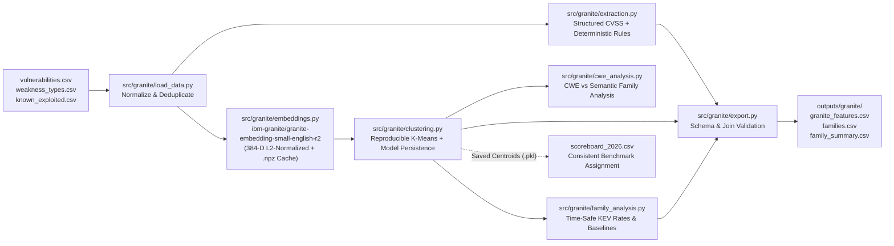

# IBM Granite Intelligence & Research Methodology

**Project:** ThreatRank — Sheridan Datathon 2026  
**Component:** Member 2 — IBM Granite Semantic Intelligence & Research  
**Branch:** `feature/granite`

---

## 1. Architecture & Pipeline Overview

The Member 2 workstream (`src/granite/`) transforms unstructured vulnerability disclosures into dense semantic representations, discovers behavioral vulnerability families, compares them against official CWE taxonomies, evaluates historical CISA KEV patterns under strict temporal leakage controls, and exports validated integration tables for Member 1 (Predictive ML) and Member 3 (Streamlit Dashboard).



---

## 2. IBM Granite Model Selection & Hardware Profile

### 2.1 Primary Embedding Model (`ibm-granite/granite-embedding-small-english-r2`)
- **Source:** Official IBM Granite collection on Hugging Face (`https://huggingface.co/ibm-granite/granite-embedding-small-english-r2`).
- **Architecture:** 47M-parameter bi-encoder transformer trained by IBM Research (`max_seq_length = 8192`, output dimension `D = 384`).
- **Local Execution:** Loaded via `sentence-transformers` and `PyTorch`. Automatically uses CUDA GPU when available and falls back to `torch.float32` on CPU (avoiding slow emulated `bfloat16` operations on Windows x86_64 CPUs, achieving ~135 descriptions/sec on CPU).
- **Deterministic Caching:** Embeddings are stored in compressed `.npz` archives under `.cache/granite/` keyed by a SHA-256 digest of `(model_id, normalize_embeddings, preprocess_version, cve_ids, descriptions)`. Unchanged inputs reload from disk in milliseconds without re-running inference, and raw 384-D vectors are never placed inside `granite_features.csv`.

### 2.2 Optional Instruction Model Assessment
- We evaluated lightweight Granite instruction models (`ibm-granite/granite-3.1-2b-instruct`). Running generative LLM inference across 72,670 benchmark CVEs on a local CPU requires multiple hours of compute. Therefore, in accordance with our build discipline, the primary pipeline relies on `granite-embedding-small-english-r2` + structured NVD fields + transparent deterministic rules, keeping generative instruction inference strictly optional.

---

## 3. Provenance Separation: Dataset vs. Deterministic Rules vs. Granite Model

To avoid conflating data sources or wasting compute reproducing existing columns, every extracted attribute in `granite_features.csv` records its exact `extraction_method`, `extraction_confidence`, and `evidence`:

1. **Directly Supplied by Dataset (`structured_cvss`):**
   - `vulnerabilities.csv` already contains `attack_vector` and `privileges_required` for 78.87% of all CVEs (and 91.26% of `scoreboard_2026.csv`).
   - **Documented Mapping:**
     - `attack_vector in {"NETWORK", "ADJACENT_NETWORK"}` $\rightarrow$ `remote_local = "remote"` (assumption: network-reachable without local host session).
     - `attack_vector in {"LOCAL", "PHYSICAL"}` $\rightarrow$ `remote_local = "local"`.
     - `privileges_required == "NONE"` $\rightarrow$ `auth_required = "no"`.
     - `privileges_required in {"LOW", "HIGH"}` $\rightarrow$ `auth_required = "yes"`.
2. **Extracted by Deterministic Rules (`deterministic_rule`):**
   - For the 21.13% of historical CVEs (and 8.74% of 2026 benchmark CVEs) missing CVSS v3 metadata, conservative regex rules check for unambiguous phrases (`"unauthenticated remote attacker"`, `"local user"`).
   - If both remote and local phrases appear, or neither appears, the extractor outputs `"unknown"` rather than guessing.
3. **Inferred by IBM Granite (`granite-embedding-small-english-r2`):**
   - `family_id` and `family_name` are derived from clustering the 384-dimensional L2-normalized Granite description embeddings.

---

## 4. Temporal Leakage Controls

All historical exploitation analyses enforce strict temporal boundaries:
- **No Post-Cutoff Labels:** For any historical cohort evaluated at cutoff $T$ (e.g., `2025-12-31`), only KEV additions with `date_added <= T` are counted.
- **No 2026 Contamination:** CVEs published in 2026 (`scoreboard_2026.csv`) are excluded from historical rate denominators (`exclude_published_after="2025-12-31"`).
- **Exploratory vs. Leakage-Free Predictive Separation:**
  - *Exploratory Descriptive Analysis:* Examines semantic families across the 2024–2025 historical cohort (`published` between `2024-01-01` and `2025-12-31`).
  - *Leakage-Free Predictive Validation:* Fits K-Means strictly on pre-cutoff 2024 disclosures and projects 2025 disclosures (and 2026 benchmark disclosures) onto the frozen 2024 centroids (`predict_semantic_clusters`) without refitting.

---

## 5. Reproducibility & Command-Line Usage

### 5.1 Environment Setup (Windows PowerShell)
```powershell
python -m pip install -r requirements.txt
```

### 5.2 Run Phase 2 Working MVP (100 Real CVEs, 5 Clusters)
```powershell
python -m src.granite.pipeline --input "data/raw/vulnerabilities(4).csv" --limit 100 --clusters 5
```

### 5.3 Run Phase 3 & 4 Historical Research + 2026 Benchmark Assignment
```powershell
python -m src.granite.pipeline `
  --input "data/raw/vulnerabilities(4).csv" `
  --published-after 2024-01-01 `
  --published-before 2025-12-31 `
  --limit 5000 `
  --clusters 10 `
  --research `
  --benchmark "data/raw/scoreboard_2026(4).csv" `
  --benchmark-limit 2000 `
  --benchmark-output-dir "outputs/granite/benchmark_2026"
```

### 5.4 Run Automated Unit Test Suite
```powershell
python -m pytest tests/granite -v
```

